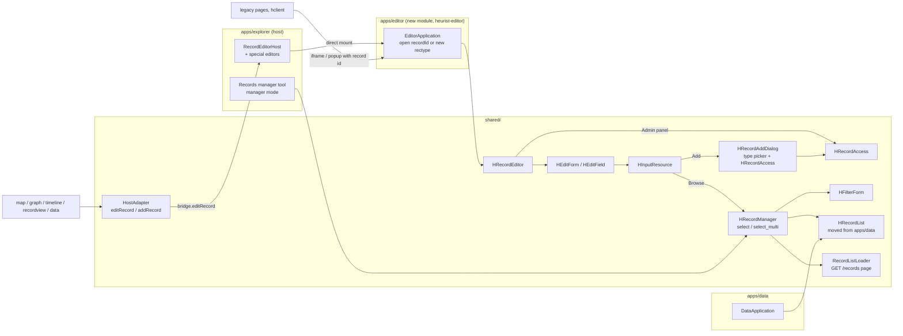

# 21 Record Manager and Pointer Modes Plan

**Status 2026-10-19:** agreed (three rounds with Artem, §9). Phases 1-4 done 2026-10-19 (not committed, not checked in a browser); next: Phase 5.

Source: Artem's notes of 2026-10-19 (HRecordManager, HInputResource and `rst_PointerMode`,
value picker buttons; second round: record editing across modules). Continues plan 14
Phase 4 (Records manager, deferred) and plan 14a (edit form).

## 1. Goal

1. **HRecordManager** = filter form + record list + "Add New *record type*" buttons, in one
   view. Two uses:
   - **a) browse / select / add** a record for a pointer field (`HInputResource`, later
     `HInputRelmaker`);
   - **b) manage** the user's system records (query sources, reports, map documents, files,
     bookmarks...) directly. System record types are going to be excluded from the general
     search, so the end user does not see them in Explorer results; the manager is the place
     where they are listed.
2. **HInputResource** follows `rst_PointerMode`.
3. **Value picker** of a pointer field gets *Browse* and *Add record* buttons.
4. **Add record** dialog for unconstrained fields with a ported **access form**
   (legacy `recordAccess.js`), shared with the Admin panel of the record editor.

## 2. Record editing and module boundaries

### 2.1 Today

```mermaid
flowchart LR
  subgraph shared["shared/ (neutral code)"]
    HRE[HRecordEditor] --> HEF[HEditForm / HEditField] --> HIR[HInputResource] --> HVP[HValuePicker]
    HFF[HFilterForm]
    HA[HostAdapter<br/>editRecord / canEditRecords]
  end
  subgraph explorer["apps/explorer (host)"]
    REH[RecordEditorHost<br/>special editors: query, rules, symbology]
    DMA[DirectModuleAdapter]
    IMA[IframeModuleAdapter]
  end
  subgraph data["apps/data"]
    DA[DataApplication] --> HRL[HRecordList]
  end
  map[apps/map] & graph[apps/graph] & tl[apps/timeline] & rv[apps/recordview] --> HA
  data --> HA
  HA -- bridge.editRecord --> IMA & DMA --> REH
  REH --> HRE
  REH -- other record types --> LEG[legacy host editor<br/>hclient]
  DMA -- imports apps/data/src/direct.js --> data
```

- Only Explorer opens HRecordEditor (through `RecordEditorHost`), and only for the
  whitelisted system types. Other types go to the legacy host editor.
- Modules ask for editing through the bridge (`HostAdapter.editRecord`). Without a host
  bridge `canEditRecords()` is false and their Edit buttons are hidden.
- `HRecordList` is in `apps/data`; it only renders pages, loading comes from
  `DataApplication` through `onDataRequest({offset, limit, filter})`.

### 2.2 Proposal



1. **A1 — no host, no editing.** Agreed: a module without a host bridge does not edit
   (as now). Nothing to change.
2. **A2 — a standalone record editor.** Opened with a record id (or a record type for a new
   record) by Explorer, by legacy pages, by any host. **How it is built is discussed first —
   §2.3.** Modules keep asking through the bridge; they never embed the editor themselves.
3. **A3 — the manager in select mode is part of every editor form.** So HRecordManager (at
   least `select` / `select_multi`) must be in **shared**: HRecordEditor in Explorer and in
   the editor module both open it without any app.
4. **A4 — move HRecordList to shared** (`shared/src/widgets/record-list/`), not a light copy.
   It is already a render-only widget with callbacks; with it move its small helpers
   (`pageEntries.js`, `ListToolControls.js`, `recordAdminInfo.js`, `recordTemplates.js`,
   HTML + CSS, about 1300 lines together). Data imports it from shared (no behaviour
   change). The manager adds a small `RecordListLoader` in `shared/src/data/` (query, sort,
   title filter, page over `GET /records/`) — the part `DataApplication` does for Data.
   Two copies of the list would need to be kept equal; one moved widget does not.
5. **Consequence:** HRecordManager does **not** embed the Data module. The "datamodule
   appearance" an admin customises (§7, later) is the HRecordList options (view mode, card
   template, page size, fields), which HRecordList already has. The Data `topBar` option of
   the first draft is replaced by a top bar in HRecordList (§4).
6. **A5 — module graph:** the hand-made diagrams above are enough for now (Artem
   2026-10-19). In the Proposal diagram `apps/editor` is option 1 of §2.3; with option 2 it
   is the editor mode of `apps/explorer`.

### 2.3 Standalone editor: separate app or Explorer in editor mode (to discuss first)

What the edit form needs from outside `shared/` today (all given by `RecordEditorHost` /
`ExplorerApplication`):

| Need | Where it is now | Without Explorer |
|---|---|---|
| Temporal editor (`HInputTemporal`, `HTemporalEditor`) | shared (plan 19) | works as is (Artem: stays integrated with the editor and HInputDate) |
| Geo: draw geometry / pick extent (`HInputGeo` `selectGeometry`, `selectExtent`) | `ExplorerApplication._drawOnMap`: Map module in an iframe dialog through `IframeModuleAdapter` (Explorer code) and `moduleUrls.map` | WKT text only, no drawing |
| Special fields of system types: query + filter form, expansion rules, field sets, geo/time field selectors, symbology | `HFilterBuilder`, `HRuleBuilder`, `HFieldSetEditor`... in `apps/explorer/src/widgets/query-source/` | readable value + Show raw only |
| Users/groups (owner pickers, login), record types (icons), definitions | `UserGroupManager`, `RecordTypeManager`, `HDbDefs` in Explorer | must be loaded again |
| File upload / pick, record view | shared + `RecordEditorHost` | works |

**Option 1 — new app `apps/editor`** (own build target, bootstrap, host adapter).
It needs its own copy of everything in the right column, or those pieces move to shared:
the Map drawing dialog (with `IframeModuleAdapter`), the query-source helper widgets
(HFilterBuilder alone is large and pulls the filter-form designer), UserGroupManager. Or it
stays a reduced editor for some record types. Two hosts for one editor.

**Option 2 — Explorer in editor mode** (agreed 2026-10-19). Same build and deploy; the bootstrap
(or URL, e.g. `?mode=editor&recID=151` / `&rty=12`) selects a small **editor shell** instead
of the full `ExplorerApplication`:
- the shell creates only `HeuristApiClient`, `UserGroupManager`, `RecordTypeManager`,
  `HDbDefs` and `RecordEditorHost`, and opens the record full-page (no dialog);
- **not** initialised: authoring dock / QSE, saved filters, query sources, layout and
  modules, control panel, history and start-up query, query trace;
- the services `RecordEditorHost` takes from `ExplorerApplication` today (`_drawOnMap` /
  `selectGeometry` / `selectFilterExtent`, `_editQueryWithBuilder`, `_describeQuery`) move
  into a small `core/EditorServices.js` used by both — this is the only refactoring;
- the shell is a separate lazy entry, so the editor page does not download the Explorer
  workspace code (Vite splits it);
- after Save / Close the shell tells its opener (`postMessage` to the iframe parent / opener
  window, or the host bridge), so legacy pages can use it instead of the legacy editor.

Why option 2 makes the design simpler:
- one host for the editor: every record type gets the same editor in Explorer and outside
  it, with geo drawing and all special editors; nothing moves to shared only for the editor;
- `RecordEditorHost` is already this host; the change is to cut it loose from
  `ExplorerApplication` (EditorServices), which is cleaner anyway;
- the manager (§3) is shared and works in both.

Cost of option 2: the editor URL is an Explorer URL; the shell must be kept free of
workspace imports (an architecture test can check this: `editor/` may not import `core/
ExplorerApplication.js`, `widgets/query-source/QuerySourcePanel.js`, layout code).

## 3. HRecordManager (shared)

`shared/src/widgets/record-manager/HRecordManager.js`, opened in a dialog by
`openRecordManager(options) → Promise<number[]|null>` (null = Cancel).

### 3.1 Options

```js
{
  selectMode: 'select' | 'select_multi' | 'manager',
  allowAddition: true | false,
  recordTypes: [rtyId, ...],   // types to list and to add; [] = unconstrained
  query: null,                 // browse filter (rst_PointerBrowseFilter), §3.3
  querySource: null,           // parameterized QS (filter form); later phase
  exclude: [recordId, ...],    // values the field already has (select_multi, §9.5)
  title: ''                    // dialog title; default from the record types
}
```

- `recordTypes: []` only for `select` / `select_multi` and only over user-data record
  types (system types are never offered there).
- `manager` mode: no Select/Cancel; records are added, edited, deleted in place (§8 Phase 5).

### 3.2 Layout

- Two panes in `HCardinalLayout`: filter form **north** or **west** (from the form
  orientation), HRecordList in the centre. Without a filter form only the list is shown.
- **Add bar** in the HRecordList top bar (§4):
  - one record type: `Add New <type name>`;
  - several types: one button per type, wrapped;
  - unconstrained: one `Add record` button → Add record dialog (§6).
  Hidden when `allowAddition` is false or the user can not create the type.
- **Footer** (select modes): `Select` and `Cancel`. `Select` takes the last selected record
  (`select`) or all selected (`select_multi`) and closes (§9.4).
- **Double-click**: in `manager` mode it opens the editor (as everywhere); in the select
  modes it selects that record and closes the manager (Artem 2026-10-19).
- **Header option buttons** (configure the list, choose QS / filter forms; owner/admin
  only) and the dialog size — deferred to the configuration phase (§9.8).

### 3.3 Query and list

- Base query = `[{t: "<recordTypes>"}]` (all user-data types when unconstrained).
- `rst_PointerBrowseFilter` (when set) **replaces the default QS** (§9.7): it is added to the
  base query; when it has no parameters there is no filter form, only the list's own title
  search. Legacy filter strings are converted with the saved-filter conversion (plan 08).
- HRecordList shows its own search and sort (existing options); no expansion, no publish.
- After Add (select modes): the new record counts as selected and the manager closes with
  it (Artem 2026-10-19). In `manager` mode the list reloads and selects it.

## 4. HRecordList changes (after the move)

1. **Top bar**: option `topBar` and method `setTopBarContent(element)` — a row above
   `header.h-recordlist-toolbar`. The manager puts the Add bar there; the list does not
   know what it is.
2. **Selection mode**: option `selectionMode: 'multi' | 'single'` (default `multi`, as now).
3. Data keeps the same behaviour; Data's tests must pass unchanged.

## 5. HInputResource and `rst_PointerMode`

`rst_PointerMode` and `rst_PointerBrowseFilter` are added to `EDIT_STRUCTURE_DETAILS` and to
the field of `buildEditStructure()` as `pointerMode` / `browseFilter`. Allowed types =
`targetTypes` (as now).

**Pointer and vocabulary constraints come from the base field only** (Artem 2026-10-19):
`rst_PtrFilteredIDs` and `rst_FilteredJsonTermIDTree` are ignored; `targetTypes` =
`dty_PtrTargetRectypeIDs`, vocabulary = `dty_JsonTermIDTree`, everywhere. Phase 3 removes
the two columns from `EDIT_STRUCTURE_DETAILS` / `buildEditStructure()` and from srv
`DefinitionLookup::structureRows()` (`termFilter` dropped). The definitions snapshot and
`HDbDefs.field()` already use the base field, so they stay as they are.

| `rst_PointerMode` | Control | Browse | Add |
|---|---|---|---|
| `dropdown_add` | value picker | picker button | picker button |
| `dropdown` | value picker | picker button | — |
| `addorbrowse` | button with the title; click opens the manager | manager | manager Add bar |
| `addonly` | button `Add <record type>` (`Add record` when unconstrained); it, or *add new value*, opens the editor of a new record; several types: type menu first; unconstrained: Add record dialog | — | editor |
| `browseonly` | button; click opens the manager | manager | — |

- **Default when empty** (§9.2): `dropdown_add` for system record types, `addorbrowse`
  for user-data types (RT_REGISTERED_FILE counts as user-data here).
- Edit / View of the chosen record stay as now.
- Without the host callbacks the input is the plain value picker without buttons.
- **Repeatable fields** (§9.5): the manager opens in `select_multi`; the first id fills this
  value, the others become new values (`HEditField`); ids the field already has are skipped.
- After Add: the new record is the value, its title remembered (`rememberLabel`).
- **HFilterForm** pointer inputs: `showBrowse: false` (§9.6).

## 6. Value picker buttons and Add record dialog

- `HValuePicker` / `HValueCombo` option `actions: [{id, icon, title, run}]`; the filter row
  becomes `filter icon | input | clear | [actions]`. The picker knows nothing about records.
- `HInputResource` options `showBrowse` (default **false**; true from edit forms) and
  `showAdd` (from `rst_PointerMode`), giving
  - `fa-table` *Browse* → `openRecordManager`;
  - `fa-plus-circle` *Add record* → `addRecord` (type menu when several types).
- **HRecordAddDialog** (unconstrained Add, port of `recordAdd.js`): record type picker (value
  picker over user-data types, grouped) + **HRecordAccess**; *Add these tags* deferred until
  user tags exist. OK opens the editor of a new record with this type, owner and visibility.
- **HRecordAccess** (`shared/src/widgets/record-access/`), port of `recordAccess.js`, used
  by the Add dialog and by the Admin panel of HRecordEditor (replaces `_renderOwnership`).
  Exact legacy behaviour (§9.1):
  - **Owner** (editable by): select of *Any logged-in user* (0), *Current user*, the user's
    groups.
  - **Viewable by** (radios):
    - *User or group specified above* (`hidden`) — with an optional list of groups that
      **can also view**; this radio is hidden when the owner is *Any logged-in user*;
    - *Any logged-in user can view* (`viewable`);
    - *Public* (`public`, viewable in published live view and exports without login).
  - Save rule: owner 0 and not public → `viewable`; `hidden` with view groups →
    `viewable` + `rec_NonOwnerVisibilityGroups`; loading `hidden` or any view groups checks
    the first radio and shows the groups.
  - The new editor today shows view groups under *Logged-in users* — wrong against legacy;
    fixed by this port.
  - **`pending` is not offered** (Artem 2026-10-19). Checked in legacy: it is not a user
    choice. `recordSave` turns `public` into `pending` when a public record is edited and
    the database setting `sys_SetPublicToPendingOnEdit` is 1 ("viewable by anyone, changes
    pending"); search and output treat it as public. srv `RecordSaveService` already does
    the same. HRecordAccess shows a `pending` record as *Public* with a note *changes
    pending approval*; saving sends `public` and the server decides.
- **Defaults of a new record**: last used owner and visibility (remembered per user, as in
  legacy `recordAdd`); first time: owner = current user, visibility = `viewable`
  (Artem 2026-10-19).

## 6a. All record types in the new editor

Artem 2026-10-19: drop the whitelist — every record type is edited in HRecordEditor (tags
and bookmarks later); a full test range over all record types is needed.

1. **Client**: `RecordEditorHost` stops checking `isWritableRecordType`; the legacy host
   editor is used only when the user is not logged in to the new API (or by a setting, as a
   way back). `writableRecordTypes.js` stays for the special editors list only.
2. **Server**: `WritableRecordTypes` checks in `RecordSaveService`, `RecordDeleteService`,
   `RecordDuplicateService` are removed (or the list becomes "all").
3. **What srv save does not do yet** for ordinary records (RecordSaveService header,
   checked 2026-10-19 against `recordModify.php`) — **none is ported in this plan**
   (Artem 2026-10-19); they stay listed for a later plan:
   - **parent/child records** (`rst_CreateChildIfRecPtr`): reverse pointer
     DT_PARENT_ENTITY on save, child records deleted with the parent;
   - **re-titling** of relationship records and of records that point to the saved one
     (their title masks use its title);
   - **entry masks** (`recordUpdateMaskFields`);
   - **workflow e-mails** (the stage rules themselves are done);
   - ElasticSearch index (save and delete), HTML cache.
4. **Edit form**: field types not yet in HEditForm for user data — `relmarker`
   (HInputRelmaker, later), and checks of `blocktext` HTML editor, `file` with remote URLs,
   `relationtype`, `separator` tabs/accordions on big types.
5. **Test range**:
   - server: `tests/RecordEditAllTypesTest.php` — for every record type of the test
     databases: build a record with a value in every field of its structure (by field type),
     POST, GET back, compare (input = output), PATCH one field, delete; plus a legacy compare
     of title and child pointers;
   - client: `shared/test` — `buildEditStructure` + HEditForm render and `values()` round trip
     for every field type and pointer mode; a fixture made from the `/rst` output of all
     record types of `osmak_mapping`;
   - browser check list in the plan (one record type per field type group).

## 7. Configuration (later)

Per record type, set by the database owner/admin: query source(s) and filter form, list
appearance (HRecordList options) and dialog size (§9.8). Stored with the built-in query
sources of §8 Phase 5.

## 8. Phases

1. **Move HRecordList to shared** (§2.2.4) + `topBar`, `selectionMode` (§4);
   `RecordListLoader`. Data unchanged, all tests pass; architecture test updated.
2. **HRecordManager** select / select_multi (§3) + `openRecordManager`; callbacks
   `browseRecords` / `addRecord` from `RecordEditorHost` through HRecordEditor → HEditForm →
   HEditField → HInputResource.
3. **Pointer modes and picker buttons** (§5, §6 first part); `pointerMode`, `browseFilter`;
   rst pointer / term filter columns no longer read (§5).
4. **HRecordAccess + HRecordAddDialog** (§6), Admin panel switched to HRecordAccess.
5. **All record types** (§6a): whitelist removed on both sides, test range. Can run beside
   Phases 1-4.
6. **Standalone editor = Explorer editor mode** (§2.3, option 2): bootstrap / URL, shell,
   EditorServices, opener messages, legacy page entry.
7. **Manager mode and configuration** (I.1b, §7), with plan 14 Phase 4: built-in
   parameterized QS per system type and a generic one for user types (code or locked
   records), admin customisation, exclusion of system types from the general search.

## 9. Agreed (Artem, 2026-10-19)

1. Unconstrained *Add record* opens an Add record dialog (legacy `recordAdd.js` →
   `recordAccess.js`): owner and visibility, the same form as Record summary → Admin.
   Legacy *Record is viewable by* is better than the new one: port its exact behaviour.
   Record type selector = value picker. *Add these tags* deferred (user tags).
2. Default pointer mode: `dropdown_add` for system record types, `addorbrowse` for
   user-data types (including RT_REGISTERED_FILE).
3. Value picker option `showBrowse` (default false; true when opened from an edit form);
   `showAdd` from `rst_PointerMode`. `addonly`: click on the empty input or *add new value*
   opens the editor of a new record.
4. The user presses *Select* in the footer: last selected (single) or all selected (multi),
   then the manager closes.
5. `select_multi` for repeatable fields: yes; on close skip values the form already has.
6. HFilterForm: `showBrowse: false` (depends on §2).
7. `rst_PointerBrowseFilter`: yes; it overrides the default query source; not
   parameterized → only the title search.
8. Popups have no resize; size goes into the configuration with QS and list appearance.

Second round (Artem, 2026-10-19):

9. Temporal stays integrated with the editor and HInputDate (shared). Standalone editor:
   discuss first whether Explorer in a special editor-only mode is better (§2.3).
10. Double-click selects in the select modes; opens the editor in `manager` mode.
11. After Add in the select modes the new record is the selection and the manager closes.
12. `addonly` shows a button `Add <record type>` / `Add record`.
13. ~~Empty rst filters fall back to the base field~~ — replaced by 18.
14. No whitelist: all record types in the new editor; full test range (§6a).
15. New records: last owner/visibility kept; default owner = current user, visibility =
    `viewable`.
16. `pending` not shown in HRecordAccess (§6).
17. Hand-made module diagrams are enough.

Third round (Artem, 2026-10-19):

18. `rst_PtrFilteredIDs` and `rst_FilteredJsonTermIDTree` are ignored; the base field values
    are used directly (§5).
19. Standalone editor = **Explorer editor mode** (§2.3, option 2).
20. Shared HRecordManager on HRecordList moved to shared, no Data module inside (§2.2).
21. None of the srv save gaps (§6a.3) is ported in this plan.
22. Add for constrained types opens the editor at once, with the remembered owner/visibility;
    the Add record dialog is only for unconstrained fields.

## 10. Open points

None at the moment (2026-10-19). Phase 6 (editor mode) gets its own short design check of
the bootstrap / URL and the opener messages before coding.

## 11. Implementation notes

### Phase 1 — HRecordList in shared (2026-10-19)

- Moved with `git mv` to `shared/src/widgets/record-list/`: `HRecordList.js/.html/.css`,
  `pageEntries.js`, `ListToolControls.js/.css`, `recordAdminInfo.js`, `recordTemplates.js`
  (also used by Data's DataTables adapter and record popup). Imports inside are relative;
  Data imports them as `#shared/widgets/record-list/...`. The template stays `?raw` (Vite).
- HRecordList options: `topBar` (row `div.h-recordlist-topbar` above the toolbar, hidden until
  `setTopBarContent(element)` gives content), `selectionMode: 'multi'|'single'` (single: a
  click replaces the selection, no shift/ctrl ranges, *Select all on page* hidden,
  `setSelection` keeps the last id). New callback `onRecordActivate(id)`: when given,
  double-click calls it instead of editing (§3.2 select modes); Data does not give it, so
  Data is unchanged.
- `shared/src/data/RecordListLoader.js`: `load({offset, limit, filter, signal})` in the
  `onDataRequest` shape, `setQuery`, `setSort`; a newer request aborts the running one; a
  counted query + filter is not counted again (`total: false`), as DataApplication does.
  Default fields `RECORD_LIST_FIELDS` (title, type, owner name, thumbnail, bookmark,
  visibility).
- Tests: `shared/test/data/recordListLoader.test.js` (loader + HRecordList source checks — the
  fake DOM cannot parse the template, as in the Data tests); Data test paths updated; all
  1230 tests pass; `build:data` and `build:explorer` pass.
- **API domain per record type** (Artem 2026-10-19): `shared/src/data/recordDomains.js` —
  `recordTypeDomain(dbdefs, rty)` → `{domain, type, path}`: `records` by default,
  RT_REGISTERED_FILE → `files` (`/files`), RT_USER_BOOKMARKS / RT_USER_REMINDERS → `system`
  with the type in the path (`/system/bookmark`, `/system/reminder`, plan 20 §5; inactive
  until the codes exist; the path names are provisional, agreed when we work on the `system`
  domain — Artem 2026-10-19); `recordTypesDomain(dbdefs, types)` refuses types of different
  domains in one list (no mixed domains — Artem 2026-10-19; a pointer field allowing types of
  two domains gets no Browse). `RecordListLoader` option `path` (default `/records`). The manager
  (Phase 2) and the editor (`RecordEditClient` `domain`) take the domain from here.
  Server (heurist): snapshot format 5 adds `dbconst.RT_REGISTERED_FILE`; on `/files`, `f`
  without a field id (the list's search box, `filter: {f: text}`) searches the title, as
  `/records` searches any field — before it failed with "Field is not available for files";
  `tests/FileApiTest.php` checks it (42 passed).
- For Phase 2: the HRecordList strings are in Data's localization files only — Explorer
  needs them (eng/fre) when it shows the manager; `recordTypeIconUrl` falls back to
  `heuristModuleBootstrap.runtime` for the base URL, so the manager passes `baseUrl` /
  `database` or sets `rec_RecTypeIconURL`.

### Phase 2 — HRecordManager, select modes (2026-10-19)

- `shared/src/widgets/record-manager/HRecordManager.js` (+ `.css`): HRecordList with
  `topBar`, `RecordListLoader` on the domain path of the types (`recordTypesDomain`; mixed
  domains → a message instead of the list), query `[{t: types}]` + `query` (extra
  conditions, for `rst_PointerBrowseFilter` in Phase 3). Select modes: `selectionMode`
  single / multi, double-click = `onRecordActivate` → finish; `manager` mode keeps
  double-click = edit and needs record types. Events `h-record-manager-selection`,
  `h-record-manager-finish`, `h-record-manager-error`.
- Add bar: `Add new <type>` per type that `canAddRecordType` allows, through the host
  `addRecord`; select modes: a saved new record finishes the manager with it; `manager` mode:
  reload + select it. **Unconstrained: no Add button yet** (the Add record dialog is
  Phase 4); unconstrained lists every user-data type on `/records`
  (`userDataRecordTypeIds`: not the writable system types, not other domains).
- `openRecordManager(options) → Promise<number[]|null>`: dialog
  `h-dialog-record-manager` (fixed size, §9.8), own dialog id (it opens over the record
  editor), Select (disabled without a selection) / Cancel; Escape and close = null;
  `manager` mode: Close → `[]`.
- No filter form pane yet: it comes with a parameterized browse filter / QS (Phase 3 and
  §7); no `exclude` option — repeated values are skipped by `HEditField` (Phase 3, §9.5).
- Plumbing: `browseRecords` and `addRecord` options through HRecordEditor → HEditForm →
  HEditField → HInputResource. `RecordEditorHost.browseRecords(options)` opens the manager
  (lazy chunk `heurist-explorer-openRecordManager.js`) with its `addRecord`,
  `canEditRecordType`, `editRecord`, `viewRecord`; also in `formServices()` (Test edit form).
  Bridge: Explorer `_hostActions().browseRecords`, IframeModuleAdapter pass-through,
  `HostAdapter.supportsBrowse()` / `browseRecords()`; `docs/integration.md` updated.
- **Interim (Phase 2 only):** HInputResource shows a `fa-table` *Browse* button beside
  Edit / View when `browseRecords` is given (`showBrowse: false` hides it); Phase 3 moves
  Browse / Add into the value picker and follows `rst_PointerMode`.
- Explorer localization: the HRecordList and manager strings (eng + fre, French from Data).
- Tests: `shared/test/recordManager.test.js` (manager logic with a stand-in list, Browse of
  HInputResource), `hostEditing.test.js` (browseRecords); the test loader
  `scripts/cssLoader.mjs` now loads Vite `?raw` imports as text, so HRecordList can be
  imported in tests. 1243 tests pass; Explorer and Data build.
- To check in the browser: a pointer field in the record editor (e.g. a Map layer's data
  source, a Map document's layers) or in the Test edit form → Browse.

### Phase 3 — pointer modes and picker buttons (2026-10-19)

Artem's review of Phase 2 (2026-10-19): Add buttons of the manager `h-btn-primary`; no value
picker unless `rst_PointerMode` is `dropdown_add` / `dropdown`, a click on the input opens the
manager (not `addonly`); no separate Browse button; Edit / View on mouse over.

- **Edit structure** (`recordEditStructure.js`): `/rst` columns `rst_PointerMode`,
  `rst_PointerBrowseFilter` instead of `rst_PtrFilteredIDs` / `rst_FilteredJsonTermIDTree`;
  `targetTypes` / `vocabulary` from the base field only; resource fields get `pointerMode`
  and `browseFilter` (non-standard fields too). Server (heurist): `DefinitionLookup::structureRows()`
  no longer reads the two rst columns (`termFilter` removed), `QueryValueResolver` term
  roots = the base field's vocabulary.
- **Default mode** — `resolvePointerMode(value, targetTypes, dbdefs)`: in `osmak_mapping`
  every pointer field has `addorbrowse` (the column default), so "not set" can not be told
  from `addorbrowse`. Rule: a pointer whose targets are all system record types
  (`writableRecordTypes`) gets `dropdown_add` for a stored `addorbrowse` or nothing; other
  stored values are kept; user-data targets (RT_REGISTERED_FILE too) keep the stored value,
  default `addorbrowse`. **To confirm with Artem.**
- **HInputResource** (rewritten): `dropdown_add` / `dropdown` = HValueCombo with picker
  `actions` *Browse* (`fa-table`, only with `showBrowse: true` — edit forms; default false,
  so filter forms have none) and *Add record* (`fa-plus-circle`, `dropdown_add`);
  `addorbrowse` / `browseonly` = a select-like button with the title and a `fa-table` icon,
  a click opens the manager (`allowAddition` for `addorbrowse` and `dropdown_add`);
  `addonly` = button `Add <type>` / `Add record` (several types: a type menu,
  `showPopover`), a click on the empty input adds a record; with a value the click does
  nothing (Edit on mouse over). Without `browseRecords` / `addRecord` the mode falls back
  to the value picker. The Phase 2 Browse button is removed. Edit / View: hidden until mouse
  over / focus (`@media (hover: hover)`; always shown on touch screens).
  Unconstrained fields: no Add yet (Phase 4).
- **HValuePicker** option `actions: [{id, icon, title, run}]` (buttons after the filter
  input; the filter row is always shown with actions); event `h-value-picker-action` closes
  HValueCombo.
- **HEditField**: resource inputs get `pointerMode`, `browseFilter`, `showBrowse: true`,
  `dbdefs`; `_browsePointer` — a repeatable field with room asks `select_multi`, the first
  new record is this value, the others become new values (up to max values), records the
  field already has are skipped (§9.5).
- **HRecordManager**: Add buttons `h-btn-primary`; browse filter `browseFilterQuery()`:
  JSON text → its conditions (a saved-filter object → its `q`), keyword text →
  `t:<types> <filter>`. Parameterized filters: as given (filter form later).
- Explorer localization: `Add record`.
- Tests: `shared/test/recordManager.test.js` (pointer mode rule, structure, browse filter,
  the five modes, picker actions, HEditField multi select). 1251 tests pass; all apps build.
  Server: DefinitionLookupTest, DefinitionSnapshotTest, RecordEditApiTest, FileApiTest,
  DataAccessBoundaryTest, SystemQueryTest, ConnectedPredicateTest, TemporalSearchTest,
  FieldValueCounterTest, QueryTraceTest pass (some older scripts in `tests/` fail on missing
  require paths, not related).

### Phase 4 — HRecordAccess and the Add record dialog (2026-10-19)

- `shared/src/data/recordAccess.js`: the legacy rules as functions — `accessFormState(header)`
  (stored `hidden` or any view groups check *User or group specified above*; `pending` shows
  as Public), `accessHeader(state)` (owner 0 and not public → `viewable`; `hidden` + groups →
  `viewable` + groups; `pending` saved unchanged while Public stays checked, so a save does not
  approve it); `loadRecordAddDefaults` / `saveRecordAddDefaults`.
- **Remembered access of new records: browser storage** (`localStorage`
  `heurist-record-add-defaults:<db>:<user>`: owner, visibility, view groups, record type), not
  the legacy user preference `record-add-defaults` (that needs the FrontController; can be
  switched later). First time: owner = current user, `viewable` (§9.15; legacy default was
  owner 0). Saved when a new record is created (RecordEditorHost, any type) and by the Add
  record dialog (with its record type).
- `shared/src/widgets/record-access/HRecordAccess.js` (+ `.css`): *Record is owned (editable)
  by* — `ownerChoices()`: Any logged-in user, Current user (name), the groups the user is a
  member / admin of; a database administrator: all groups and all users; the current owner
  always kept. *Record is viewable by* — the three legacy radios; the view groups (groups
  only, as legacy `sysGroups`) under the first radio; the first radio hidden for owner 0 (then
  *Any logged-in user* is checked unless Public). Option `editGroups` = *Also editable by*
  (`rec_EditGroups`, users and groups) — **kept for the record editor, not in the legacy form**.
- HRecordEditor: the Admin panel / ownership pane is HRecordAccess (`editGroups: true`); the
  old select *Visible to* (with `pending` as a choice) and *Only these groups* under
  *Logged-in users* are removed. New option `access` = owner / visibility of a new record.
- `openRecordAddDialog({dbdefs, database, recordTypes})` (`record-access/`): record type
  picker (value picker, user-data types grouped by record type group, last type preselected)
  + HRecordAccess; *Add record* / Cancel → `{rectypeId, access}` or null. No *Add these tags*
  (user tags later).
- **One entry point for "any type"**: shared code calls the host's `addRecord(null)`;
  `RecordEditorHost.addRecord(null)` shows the dialog (lazy chunk) and opens the editor of the
  chosen type with the chosen access. `addRecord(type)` for a constrained field opens the
  editor at once with the remembered access (§9.22). The manager shows *Add record* for an
  unconstrained list (`canAddRecordType(null)` = logged in); HInputResource without a type
  constraint gets *Add record* in `dropdown_add` / `addorbrowse` (manager) and the `addonly`
  button `Add record`.
- Until Phase 5 the record editor still opens only the whitelisted types; other types go to
  the legacy host editor, which ignores the chosen access.
- Explorer localization: the form and dialog texts (eng + fre).
- Tests: `shared/test/recordAccess.test.js` (rules, remembered defaults, owner list, the form,
  pending, dialog type list, unconstrained Add of HInputResource); the manager and host tests
  updated. 1259 tests pass; Explorer, Data and Map build.

